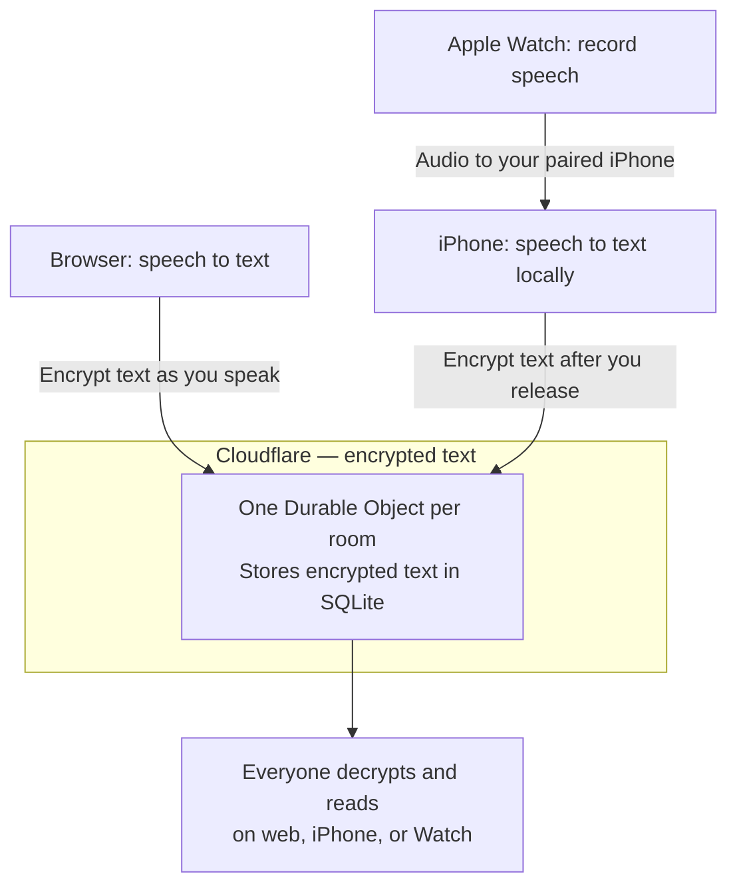

# talk-bugs

**Speak to send. Read to receive.**

A group chat with no typing and no voice playback. Open a room, share its link, and talk.

[Open the app](https://talk-bugs.roundtrip.workers.dev) · [Build for iPhone and Apple Watch](native/README.md)

## Try it

1. Open the app. You're already in a room—no account or welcome page.
2. Share the room link with someone.
3. Hold **Hold to talk**, speak, then release.

```text
You speak       “I'll meet you outside.”
                            │
                            ▼
They read        I'll meet you outside.

They speak      “Give me two minutes.”
                            │
                            ▼
You read         Give me two minutes.
```

Everyone can speak at once. Nobody hears anyone else's audio through the app.

## A screen for reading

Your main screen shows **other people's words**. Your own words are in **History**.

```text
┌──────────────────────────────────────────┐
│ talk-bugs                      History   │
│                                          │
│ Person 2                      Speaking   │
│ I'll meet you outside.        ← current  │
│ ──────────────────────────────────────── │
│ I'm leaving now.              ← previous │
│                                          │
│ Person 3                                 │
│ Give me two minutes.          ← current  │
│                                          │
│             [ Hold to talk ]             │
└──────────────────────────────────────────┘
```

Each person keeps their place, even when people talk over each other. Corrections change the words in place without moving your scroll position. Silent people take no space.

On Apple Watch, each speaker gets a page. Swipe between people.

## Where the words go



A Durable Object is the room's coordinator: it saves changes and shares them with everyone. Cloudflare Workers also serves the web app. There is no other application backend.

| | Web | iPhone | Apple Watch |
| --- | --- | --- | --- |
| Turns speech into text | Browser speech recognition | On the iPhone | On the paired iPhone |
| Sends words | While you speak | After you release | After the phone transcribes |
| Receives words | Live over WebSocket | Checks every second while open | Checks every second while open |
| Hold length | Up to 4,000 characters | Up to 30 seconds | Up to 30 seconds |

**New rooms encrypt text before it reaches Cloudflare.** Browser recognition uses an installed local English speech pack when available; otherwise, the browser may send audio to its vendor. The native apps transcribe on the iPhone, with no cloud fallback. Watch delivery can wait if the phone is unavailable or asleep.

Speech recognition is set to US English. Browsers without speech recognition can still read and invite people. Speaking requires microphone permission and HTTPS or localhost.

## Private rooms, one link

```text
Invite link = room address + secret key
              /e/room-id    #key=…
```

New rooms are end-to-end encrypted. Share the full link: the part after `#` unlocks the words and stays out of server requests. Anyone with that link can read the room. Older `/r/` links keep working without encryption; start a new room to use it.

The key is shared by everyone in the room. Leaving does not revoke access, and a leaked key can unlock saved encrypted messages. Browser transcription may still use its provider's service. See [how encryption works](docs/encryption.md).

## How live corrections work

Speech recognition can change its mind. Each update replaces the same message:

```text
One hold → one message

Update 1       “Meet me at the”
Update 2       “Meet me at the park”
Update 3       “Meet me at the parking lot.”
Release        “Meet me at the parking lot.”  ✓ finished
```

| When… | The app… |
| --- | --- |
| Two people speak at once | Updates each person's message separately. |
| Words arrive quickly | Sends the latest web update every 100 ms; sends the finished turn immediately. |
| An old update arrives late | Ignores it using the message ID and update number. |
| A message is finished | Keeps it unchanged. |
| A connection drops | Reloads saved text and retries unconfirmed updates on reconnect. |

The room saves each change before confirming it. The 100 ms timer controls how often the app sends updates. Recognizing speech and moving text over the network also take time.

## Run it locally

With Node.js and npm installed:

```sh
git clone https://github.com/irvinebroque/talk-bugs.git
cd talk-bugs
npm ci
npm run dev
```

Open the printed URL. Share the room link between separate browser windows to try a conversation. A localhost link only works on your computer.

The web UI uses React and default [shadcn/ui](https://ui.shadcn.com/docs/) components. For SwiftUI, Xcode setup, shortcuts, and Watch complications, see the [native guide](native/README.md).

### Check your changes

```sh
npm run typecheck
npm test
npm run test:e2e
npm run build
```

Browser tests use Google Chrome. If it's missing, run `npx playwright install chrome`.

### Deploy to Cloudflare

```sh
npx wrangler login
npm run deploy
```

No application API keys or secrets are needed. [wrangler.jsonc](wrangler.jsonc) defines the room binding and database migration. After changing bindings, run `npm run cf-typegen` and commit the generated types.

## Know the limits

| | Current behavior |
| --- | --- |
| Room access | Anyone with the full invite can read. New rooms use end-to-end encryption; no accounts. |
| Room size | Up to 24 connected people. |
| Message size | Up to 4,000 characters per turn. |
| History | Latest 200 turns; the app removes messages after 24 hours. |
| Web reloads | Saved words survive. Unsent words in page memory do not. |
| Native retries | Up to 20 pending jobs. Jobs older than 24 hours are removed when the app launches or refreshes. |
| Background reading | Native apps pause reading. No push notifications yet. |

## What has been checked

| Check | Status |
| --- | --- |
| Simultaneous speakers, corrections, reconnects, and separate rooms | Automated tests pass. |
| Push-to-talk and reading views | Browser and native simulator checks pass, using simulated speech. |
| iPhone and Watch builds | Pass. |
| Real microphones, Watch audio transfer, and locked-phone delivery | Still need physical-device testing. |

See the [native validation details](native/README.md#validation) for what simulators can and cannot test.
